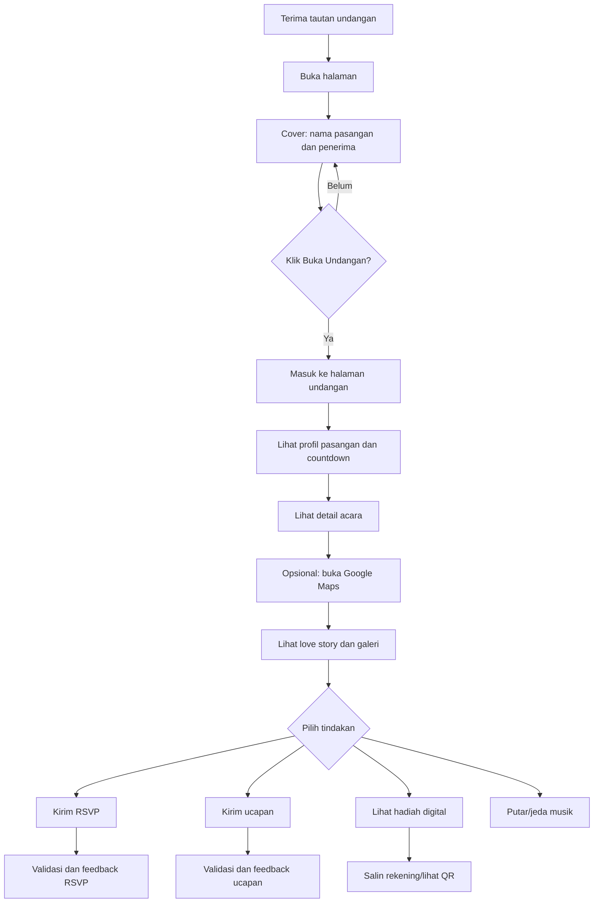

# USER FLOW — Wedding Invitation Website

> Status: Baseline SOT | Versi: 1.0

## 1. Alur Utama Tamu

## 2. Flow Cover dan Navigasi
1. Tamu membuka URL undangan.
2. Sistem membaca parameter penerima opsional, misalnya `?to=Nama%20Tamu`.
3. Cover menampilkan nama pasangan, tanggal, dan sapaan penerima jika tersedia.
4. Tamu menekan tombol **Buka Undangan**.
5. Sistem membuka konten utama, mengaktifkan navigasi, dan mengizinkan musik hanya jika tamu menekan kontrol musik.
6. Navigasi mengarah ke section yang sesuai dan menu mobile dapat ditutup setelah item dipilih.

## 3. Flow RSVP
1. Tamu menuju bagian RSVP.
2. Mengisi nama, status kehadiran, jumlah tamu (bila hadir), dan catatan opsional.
3. Sistem memvalidasi field wajib dan batas jumlah tamu.
4. Tamu menekan Kirim.
5. Tombol masuk state loading dan mencegah pengiriman ganda.
6. Jika berhasil, tampilkan konfirmasi sukses dan reset field yang aman.
7. Jika gagal, pertahankan input dan tampilkan pesan yang dapat ditindaklanjuti.

Aturan: jika status `Tidak Hadir`, jumlah tamu dinormalisasi menjadi 0 atau tidak dikirim sesuai kontrak API. Batas jumlah tamu harus berasal dari konfigurasi undangan.

## 4. Flow Ucapan dan Doa
1. Tamu melihat daftar ucapan.
2. Sistem menampilkan loading, daftar, atau empty state.
3. Tamu mengisi nama dan pesan.
4. Sistem memvalidasi panjang pesan dan membersihkan input.
5. Setelah submit, tampilkan loading.
6. Setelah sukses, ucapan baru muncul sesuai kebijakan moderasi API.
7. Jika gagal, tampilkan error dan pertahankan input.

## 5. Flow Hadiah Digital
1. Tamu menuju bagian hadiah.
2. Tamu melihat opsi rekening/e-wallet/QR yang diaktifkan pemilik.
3. Tamu menekan tombol salin.
4. Sistem menyalin nomor/teks ke clipboard.
5. Sistem memberi feedback berhasil atau instruksi salin manual jika clipboard tidak tersedia.

## 6. Flow Musik
- Musik dalam keadaan berhenti secara default.
- Tamu menekan kontrol play untuk memulai.
- Kontrol berubah menjadi pause dan menampilkan status yang mudah dikenali.
- Jika file audio gagal dimuat, tampilkan status non-blocking; seluruh undangan tetap dapat digunakan.

## 7. State UI yang Wajib
- Initial/loading.
- Success.
- Validation error.
- Network/server error.
- Empty list (ucapan).
- Event date passed (countdown).
- Clipboard unavailable.
- Audio unavailable.
- Reduced-motion preference aktif.

## 8. Flow Responsif
- Mobile: navigasi ringkas, tombol sentuh nyaman, konten satu kolom bila perlu, galeri 2 kolom atau 1 kolom sesuai lebar.
- Tablet/desktop: layout lebih lebar, profil pasangan berdampingan, timeline dan galeri menyesuaikan grid.
- Semua aksi penting tetap dapat dijangkau tanpa hover.
